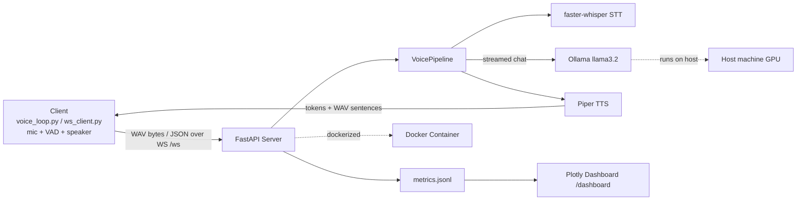

# Local Voice Assistant

An end-to-end, fully local **voice assistant** that goes from **speech-to-text basics** to a **real-time streaming voice API**, with a FastAPI backend, WebSocket streaming, a hands-free conversation loop with interrupt, a Plotly latency dashboard, and Docker containerization.

Speak -> **faster-whisper** transcribes -> **Ollama** (`llama3.2`) replies -> **Piper** speaks, sentence by sentence, while the LLM is still generating. No cloud APIs.

## Overview

This project was built as a structured, phase-by-phase learning journey:

1. Set up the project, environment and a setup-check script
2. Add speech-to-text (faster-whisper) with a mic recorder
3. Connect a local LLM through Ollama with streaming and chat history
4. Add text-to-speech with Piper
5. Wrap the pipeline in a FastAPI backend (STT -> LLM -> TTS)
6. Stream everything over a WebSocket (sentence-level TTS, per-connection history)
7. Optimise LLM latency and add voice activity detection (VAD)
8. Build a hands-free loop with interrupt (barge-in)
9. Add a Plotly latency dashboard
10. Containerize the server with Docker
11. Publish to GitHub

## Architecture



Turn flow: `mic audio -> STT -> LLM tokens (streamed) -> sentence splitter -> TTS per sentence -> audio streamed back -> speaker`.

## Features

- **Fully local pipeline:** speech-to-text, LLM and text-to-speech all run on your machine
- **Streaming replies:** the first sentence is spoken while the LLM is still generating the rest
- **Hands-free conversation:** always-on mic with voice activity detection (VAD), no button presses
- **Interrupt (barge-in):** start talking while the assistant speaks and it stops, cancels generation and listens
- **Per-connection chat history** with reset
- **Latency optimisation:** model `keep_alive`, start-up warm-up, short system prompt, bounded history
- **Real-time dashboard:** Plotly charts for STT, LLM first token, LLM total, TTS and first-audio timings
- **REST + WebSocket APIs** plus small CLI tools to test each stage on its own
- **Containerized:** the server (STT + TTS + dashboard) runs in Docker while Ollama and the mic/speaker clients stay on the host
- **CPU-friendly speech models:** Whisper runs on CPU (int8) and Piper is lightweight; only the LLM uses the GPU through Ollama

## Tech Stack

| Category | Technology |
|---|---|
| Speech-to-Text | faster-whisper (CPU, int8) |
| LLM | Ollama (`llama3.2`), httpx streaming |
| Text-to-Speech | Piper (`piper-tts`), soundfile, sounddevice |
| Backend | FastAPI, Uvicorn, WebSockets |
| Monitoring | Plotly, JSONL metrics log |
| Containerization | Docker, Docker Compose |
| Language | Python 3.11 |


Each write-up covers what was built, the errors hit and how they were fixed, the final commands, and notes.

## Project Structure

```
voice_assistant/
├── voice_assistant/
│   ├── config.py              # settings loaded from .env
│   ├── pipeline.py            # STT -> LLM -> TTS pipeline, streaming turns
│   ├── api/
│   │   ├── main.py            # FastAPI: REST, /ws, /metrics, /dashboard
│   │   ├── voice_loop.py      # hands-free client (VAD + interrupt)
│   │   ├── ws_client.py       # WebSocket test client (text / push-to-talk)
│   │   └── test_client.py     # REST test client
│   ├── llm/                   # Ollama client + test CLI
│   ├── stt/                   # recorder, transcriber, VAD recorder, mic level tool
│   ├── tts/                   # Piper synthesizer, voice downloader
│   ├── monitoring/            # metrics log + Plotly dashboard
│   └── utils/                 # sentence splitter, setup checker
├── docs/                      # one write-up per phase
├── Dockerfile
├── docker-compose.yml
├── requirements.txt
└── .env.example
```

## Setup

**Prerequisites:** Python 3.11, [Ollama](https://ollama.com), a microphone and speakers/headphones. Docker Desktop is only needed for the container setup.

### 1. Clone and set up the environment

```bash
git clone https://github.com/ThePrakashV/local-voice-assistant.git
cd local-voice-assistant

python -m venv venv
venv\Scripts\activate        # Windows
# source venv/bin/activate   # Linux/Mac

python -m pip install --upgrade pip "setuptools<81" wheel
pip install -r requirements.txt --prefer-binary

ollama pull llama3.2
copy .env.example .env       # Windows (cp .env.example .env on Linux/Mac)
```

### 2. Check the environment and download a voice

```bash
python -m voice_assistant.utils.check_setup
python -m voice_assistant.tts.download_voice
```

The Piper voice (about 60 MB) is downloaded once into `models/voices/`. The Whisper model (`base`) downloads automatically on first use.

### 3. Run the server locally

```bash
python -m voice_assistant.api.main
```

Visit `http://127.0.0.1:8000/docs` for interactive API docs.

### 4. Talk to it (second terminal, venv activated)

```bash
# list audio devices (numbers differ per machine)
python -m voice_assistant.stt.test_stt --list
python -m voice_assistant.tts.test_tts --list-out

# typed message, reply is streamed and spoken
python -m voice_assistant.api.ws_client --text "Tell me about the moon in five sentences" --out-device 3

# push-to-talk (records 5 seconds)
python -m voice_assistant.api.ws_client --seconds 5 --device 1 --out-device 3 --language en

# hands-free conversation with interrupt (use headphones)
python -m voice_assistant.api.voice_loop --device 1 --out-device 3 --language en
```

Useful `voice_loop` options: `--no-interrupt`, `--interrupt-threshold`, `--interrupt-blocks`, `--silence`, `--threshold`.

### 5. Run with Docker

```bash
docker compose build
docker compose up -d
docker logs -f voice-assistant
```

- The container runs the server (Whisper + Piper + dashboard). **Ollama and the mic/speaker clients stay on the host**, because Docker Desktop on Windows does not expose the mic and speakers to containers. The container reaches Ollama through `host.docker.internal:11434`.
- `docker-compose.yml` maps **host port 8001 to container port 8000**. Set `APP_PORT=8001` in your `.env` so the host clients connect to it.
- It mounts your host Hugging Face cache and sets `HF_HUB_OFFLINE=1`, so run the server once on the host first to cache the Whisper model. (In the author's setup, downloading the model inside the container stalled.)
- `./models`, `./data` and `./logs` are mounted as volumes. The cache path uses `${USERPROFILE}` (Windows); adjust it on Linux/Mac.

## Configuration

Settings live in `.env` (see `.env.example`).

| Variable | Default | Meaning |
|---|---|---|
| `OLLAMA_BASE_URL` | `http://localhost:11434` | Ollama address. On Windows prefer `127.0.0.1` |
| `OLLAMA_MODEL` | `llama3.2` | LLM model |
| `OLLAMA_KEEP_ALIVE` | `30m` | How long Ollama keeps the model loaded |
| `OLLAMA_NUM_CTX` | `2048` | Context size |
| `MAX_HISTORY` | `6` | Conversation turns kept |
| `WHISPER_MODEL` | `base` | `tiny`, `base`, `small`, `medium`... |
| `PIPER_VOICE` | `en_US-lessac-medium` | Piper voice name |
| `VAD_SILENCE_SECONDS` | `1.0` | Silence that ends an utterance |
| `VAD_MIN_THRESHOLD` | `0.01` | Minimum speech threshold (mic specific, tune it) |
| `APP_PORT` | `8000` | Server port |

## API Endpoints

| Endpoint | Method | Description |
|---|---|---|
| `/health` | GET | Server status, LLM model and TTS voice |
| `/chat` | POST | Text in, LLM reply out (shared history) |
| `/stt` | POST | Audio upload to transcript |
| `/tts` | POST | Text to WAV audio |
| `/voice` | POST | Audio upload to transcript, reply and reply audio URL |
| `/reset` | POST | Clear the shared chat history |
| `/audio/{filename}` | GET | Download a generated reply |
| `/metrics` | GET | Recent turn timings (JSON) |
| `/dashboard` | GET | Plotly latency dashboard (`?refresh=10` to auto-refresh) |
| `/ws` | WebSocket | Streaming conversation with interrupt |
| `/docs` | GET | Interactive Swagger UI |

### WebSocket protocol

The client sends audio as a binary frame (WAV bytes) or JSON like `{"type": "text" | "config" | "cancel" | "reset", ...}`. The server replies with `ready`, `transcript`, `token`, `sentence` (JSON followed by a binary WAV frame), and exactly one terminal event per turn: `done`, `cancelled` or `error`. Sending new audio or text while a turn is running cancels the running turn.

### Example request

```json
POST /chat
{
  "text": "What is the capital of France?"
}
```

## Viewing Latency Stats

After a few turns, open `http://127.0.0.1:8000/dashboard`, or generate a static page:

```bash
python -m voice_assistant.monitoring.dashboard --open
```

This creates an interactive HTML page at `data/dashboard.html` with four charts: first audio vs total, stage timings per turn, distribution, and a summary table.

## Performance

Measured on the author's Windows machine (Ollama `llama3.2` on GPU, Whisper `base` on CPU). Your numbers will differ.

| Metric | Observed |
|---|---|
| LLM first token (after warm-up, `127.0.0.1`) | about 0.5 s |
| First audio, typed 5-sentence question | about 1.4 - 1.8 s (full reply about 4 s) |
| STT, push-to-talk turns (5 s recording) | about 1.25 - 1.3 s |
| Hands-free: end of speech to first audio | about 2.5 - 5.4 s (STT 1.15 - 3.4 s depending on utterance length) |

Two fixes made the biggest difference: using `127.0.0.1` instead of `localhost` for Ollama (removed a fixed delay of about 2 s on Windows) and keeping the model loaded (`keep_alive` plus warm-up) so the first request is not a cold start.

## Notes

- **English TTS only.** The Piper voice used is English, so Tamil text will not be spoken correctly. Whisper can transcribe Tamil (better with `small` or `medium`), but accuracy varies.
- **Use headphones for interrupt.** With speakers, the assistant's own voice can reach the mic and trigger an interrupt or a false turn.
- **False triggers:** a click or noise that passes the VAD threshold can produce an empty transcript, and the assistant then answers with a "could not understand" fallback. Silencing this case is not implemented yet.
- **VAD threshold is mic specific.** The author's mic outputs exact zeros when silent, so `VAD_MIN_THRESHOLD` does the work. Use `python -m voice_assistant.stt.mic_level` to measure your own levels.
- **STT runs on CPU** and is the largest part of the hands-free latency.
- Developed and tested on **Windows** only.
- Built and debugged step by step, with every phase's issues and fixes documented in `docs/`.

## Acknowledgements

[faster-whisper](https://github.com/SYSTRAN/faster-whisper), [Ollama](https://ollama.com), [Piper](https://github.com/OHF-Voice/piper1-gpl), [FastAPI](https://fastapi.tiangolo.com), [Plotly](https://plotly.com/python/).
